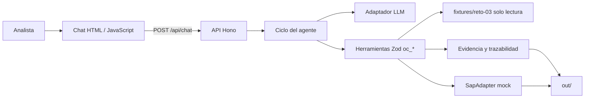

# Solución — Reto 03 · Órdenes de Compra SAP

## 1. Problema en una frase

La analista administrativa digita órdenes de compra y valida de memoria proveedores, topes y aprobaciones, lo que genera errores, retrabajo y OC retroactivas sin medición. Le duele directamente a Administración y, por control y cierre, a Contabilidad y Auditoría.

## 2. Arquitectura



| Pieza | Ubicación | Responsabilidad |
|---|---|---|
| Front | `web/` | Historial, llamadas a herramientas, payload y confirmación visible. |
| Backend | `src/server.ts` | API HTTP, sesiones, rate limit y serving del front. |
| Ciclo | `src/agent/ciclo.ts` | Bucle modelo → herramientas, topes y confirmación humana. |
| Prompt | `agent/prompt.md` | Comportamiento y restricciones del agente. |
| Conocimiento | `src/knowledge/ordenes-compra.md` | Reglas operativas explicadas al modelo. |
| Ejecución | `src/tools/oc.ts`, `src/domain/` | Herramientas, RC1–RC10, evidencia y trazabilidad. |
| SAP | `src/sap/adapter.ts`, `src/sap/mock.ts` | Contrato de integración y simulación persistida. |
| Datos | `fixtures/reto-03/` | Paquetes y maestros ficticios, siempre en solo lectura. |
| Salida | `out/` | Logs, control, evidencia, trazabilidad y órdenes simuladas. |

El módulo bonus se genera desde las fuentes de aplicación con `npm run sync-modulo`; evita que prompt y conocimiento diverjan de `modulo/`.

## 3. Ciclo del agente

En cada turno el backend conserva el historial de sesión, agrega el system prompt y ejecuta como máximo `MAX_ITER` iteraciones de modelo → herramienta. También limita el consumo acumulado con `MAX_TOKENS_SESION`; al alcanzar alguno de los topes responde con las acciones terminadas y el paso pendiente. Cada llamada se valida con Zod antes de ejecutar, devuelve `{ ok, data }` o `{ ok, error }`, aparece en el chat y queda en `out/log.jsonl`.

La confirmación humana se controla fuera del modelo. Al construir un payload con excepciones, se guarda un estado temporal atado a sesión, caso y digest SHA-256 del payload, con vencimiento de diez minutos. Solo el siguiente turno afirmativo autoriza la creación; `oc_crear` vuelve a leer fixtures, revalida controles y compara el payload antes de escribir. Un `confirmado: true` generado por el modelo no autoriza por sí solo. El caso sin confirmaciones continúa automáticamente, como exige el flujo normal de `sol-001`.

Un timeout del proveedor, error de herramienta o paquete inválido devuelve un mensaje legible y conserva la sesión para reintentar. Los límites, timeout y rate limit se configuran por ambiente.

## 4. Elección del modelo

El proveedor principal es Anthropic mediante el SDK oficial y el modelo por defecto es `claude-opus-5`; se eligió por la calidad esperada en seguimiento de instrucciones y uso de herramientas. Como alternativa local se soporta Ollama por `LLM_PROVIDER=ollama`, útil para desarrollo sin exponer una clave externa.

No se ejecutaron llamadas reales durante la validación entregada; por ello el costo se declara como estimación y no como dato medido. Un caso normal requiere aproximadamente cuatro intercambios de modelo y herramientas: lectura, validación, construcción/evidencia y cierre. Con un supuesto conservador de 12.000 tokens de entrada y 1.500 de salida por caso, y tarifas de referencia de USD 5 / millón de entrada y USD 25 / millón de salida para Opus 5, el costo estimado es **USD 0,10 por caso**:

```text
(12.000 × 5 + 1.500 × 25) / 1.000.000 = USD 0,0975
```

Los casos con confirmación agregan un turno y deben medirse en el despliegue. Antes de producción se registrarán tokens reales y se ajustará el presupuesto con las tarifas vigentes del proveedor. La demo determinista no consume tokens de pago.

## 5. Matriz de controles

| Regla | Implementación | Resultado |
|---|---|---|
| RC1 | Busca proveedor por NIT o nombre normalizado y valida que esté activo. | Bloqueo. |
| RC2 | Exige correo con “Aprobado” y remitente autorizado para el centro. | Bloqueo. |
| RC3 | Compara total de solicitud contra el tope del aprobador. | Bloqueo. |
| RC4 | Verifica que la subárea pertenezca al centro de costo. | Bloqueo. |
| RC5 | Compara el TOTAL de cotización y solicitud; >2 % o cotización ausente requiere confirmación. Moneda distinta bloquea. | Confirmación o bloqueo. |
| RC6 | Si falta IVA, deriva el indicador predeterminado del proveedor. | Derivado + confirmación. |
| RC7 | Si falta condición de pago, deriva la predeterminada del proveedor. | Derivado informado. |
| RC8 | Si la factura es anterior a la solicitud, marca `retroactiva = true`. | Confirmación + control. |
| RC9 | Compara fecha de aprobación y fecha de solicitud. | Confirmación. |
| RC10 | Comprueba cantidad × valor unitario con tolerancia de una unidad monetaria. | Bloqueo. |

La regla más delicada fue RC5: el parser toma exclusivamente la línea `TOTAL` para no confundir subtotal, IVA o base gravable. El agente no corrige montos para forzar una coincidencia; expone la diferencia y solicita decisión humana.

## 6. Diseño del adaptador SAP real

Antes de integrar se validaría la versión de SAP, extensiones disponibles y política corporativa. La opción preferida sería OData `API_PURCHASEORDER_PROCESS_SRV` mediante SAP Integration Suite, porque permite desacoplar el agente de conectividad, observabilidad y secretos corporativos.

| Payload del reto | Mapeo propuesto |
|---|---|
| `referencia.solicitud_id` y `correo_id` | Campo de referencia externa o texto de cabecera, según extensión disponible. |
| Sociedad y organización de compras | Cabecera de la orden. |
| Proveedor, moneda y condiciones de pago | Datos de cabecera. |
| Aprobador, fecha y hash de evidencia | Extensión Z de cabecera o anexo documental. |
| Posiciones 10, 20… | Ítems de la orden; descripción breve, cantidad, precio, IVA e imputación. |
| Centro de costo y subárea | Imputación de cuenta y atributo de clasificación/extensión acordada. |
| Excepciones confirmadas | Texto de cabecera, extensión de auditoría o expediente adjunto. |

Las credenciales vivirían en un gestor de secretos del conector, con cuenta técnica de mínimo privilegio, rotación y auditoría; nunca en el prompt, repositorio, frontend o logs. Para idempotencia se persistiría una clave única por `solicitud_id`, se consultaría la referencia antes y después de cada reintento y se conciliarían respuestas dudosas antes de reenviar. Si SAP crea la OC pero falla un anexo, se registra incidencia y se reintenta solo el adjunto.

**Plan B:** si la conectividad no es viable, el agente sigue entregando valor al generar payload validado, evidencia, trazabilidad, `control.csv` y un archivo de carga o vista lista para digitación supervisada.

## 7. Lectura del proceso

Una OC creada después de la factura es una excepción medible, no una autorización implícita. A dirección le reportaría cantidad y proporción de retroactivas por centro de costo, proveedor, subárea y periodo, usando `control.csv`; no inferiría comportamiento productivo desde los seis fixtures. También separaría retroactividad confirmada, rechazada y bloqueada para distinguir falta de planeación de casos realmente urgentes.

El cambio propuesto es establecer una compuerta previa al compromiso: solicitud y cotización completas, aprobación contra tope y creación de OC antes de recibir la factura. Las excepciones retroactivas entrarían a una cola visible con justificación, confirmación humana y responsable. Así se conserva la operación cuando es necesaria, pero se hace visible la causa y se puede corregir el proceso de origen.

## 8. Decisiones y trade-offs

1. **JSONL y CSV en lugar de base de datos.** Se descartó una base de datos para mantener la demo autocontenida y verificable. A cambio, producción exige transacciones, exclusión mutua y una clave única persistida.
2. **Confirmación de servidor con digest, en lugar de confiar en `confirmado: true` del modelo.** Se descartó la autorización declarativa del LLM porque una instrucción maliciosa o un modelo débil podría crear una OC sin una decisión humana válida.
3. **Fixtures normalizados, en lugar de OCR, correo vivo y binarios.** Se descartó leer PDF/XLSX reales porque el reto entrega equivalentes normalizados y prioriza determinismo. Producción requerirá extractores, antivirus y validación documental.
4. **Herramientas Zod importables, en lugar de lógica en el prompt.** Se descartó resolver controles con instrucciones textuales porque los montos, maestros y decisiones deben ser verificables y auditables fuera del modelo.
5. **Un SAP mock con el contrato `SapAdapter`, en lugar de simular SAP dentro de la herramienta.** Se descartó acoplar la persistencia a `oc_crear` para permitir reemplazar el adaptador local por integración real sin modificar el ciclo del agente.

## 9. Supuestos

- Los maestros ficticios son completos; producción los consultará en SAP o una fuente maestra vigente.
- Sociedad y organización de compras son `1000`.
- Cada solicitud del fixture genera una sola posición; una implementación real debe soportar múltiples ítems.
- La descripción breve se recorta a 40 caracteres; la unidad es `UN`, excepto descripciones de horas (`H`).
- El total de solicitud es el importe de referencia y los totales de cotización incluyen IVA.
- El correo de aprobación es evidencia suficiente para el reto; Auditoría podría requerir firma o identidad verificable.
- La confirmación registra un identificador de sesión ficticio, no identidad corporativa autenticada.
- La política definitiva para OC retroactivas —tolerar con marca o rechazar— es una decisión pendiente del negocio.

## 10. Cobertura

| Historia / entregable | Estado | Pendiente para producción |
|---|---|---|
| HU-1 · Leer paquete | Hecho | Ingesta de correo, PDF y XLSX binarios. |
| HU-2 · Validar RC1–RC10 | Hecho | Consulta de maestros vigentes y reglas parametrizadas. |
| HU-3 · Construir payload trazable | Hecho | Mapeo acordado con la API SAP real y múltiples posiciones. |
| HU-4 · Evidencia | Hecho: TXT y PDF | Firma, cadena de custodia y fuentes Unicode para correos extensos. |
| HU-5 · Crear OC | Hecho: SAP simulado e idempotencia | Transacción, lock multiproceso y reconciliación SAP. |
| HU-6 · Errores | Parcial | Taxonomía operativa, alertas y telemetría. |
| P1 · `oc_leer_excel` | No hecho | No existe XLSX binario en los fixtures entregados. |
| Bonus · `modulo/` | Hecho | Prueba de integración en la plataforma destino. |
| URL pública | No hecho | Despliegue con variables de entorno y monitoreo. |

## 11. Uso de IA

Se utilizó **PERXIA**, asistente de ingeniería, para analizar el PRD, explorar el repositorio, implementar el flujo TypeScript, revisar controles y ejecutar verificaciones locales. No se emplearon otros asistentes ni se ejecutaron respuestas de un modelo LLM real como evidencia funcional.

Se descartaron tres propuestas: autorizar la OC usando únicamente `confirmado: true` del modelo, porque contradice la confirmación humana; alterar los valores de solicitud para igualar una cotización, porque oculta la excepción RC5; y añadir OCR a esta entrega, porque los fixtures suministrados ya están normalizados y no permiten validarlo honestamente.

## 12. Riesgos de producción y mitigación

| Riesgo | Mitigación |
|---|---|
| El mock JSONL no coordina procesos concurrentes. | Usar base transaccional, lock distribuido y restricción única por solicitud. |
| SAP no responde o crea parcialmente. | Idempotencia por referencia, conciliación previa a reintentos y cola de incidencias. |
| Datos y evidencia sensibles. | Cifrado, RBAC, retención, auditoría y almacenamiento documental corporativo. |
| Aprobación por correo falsificada. | Validar identidad corporativa, firma y flujo de aprobación verificable. |
| El modelo intenta alterar o inventar datos. | Valores solo desde herramientas, Zod, revalidación previa a crear y confirmación de servidor. |
| Sesiones y rate limit locales no escalan a clúster. | Redis o almacenamiento central, rate limit distribuido y cuota por usuario. |
| PDF con alfabetos no latinos. | Fuente Unicode incrustada, paginación y pruebas con evidencia real anonimizada. |
